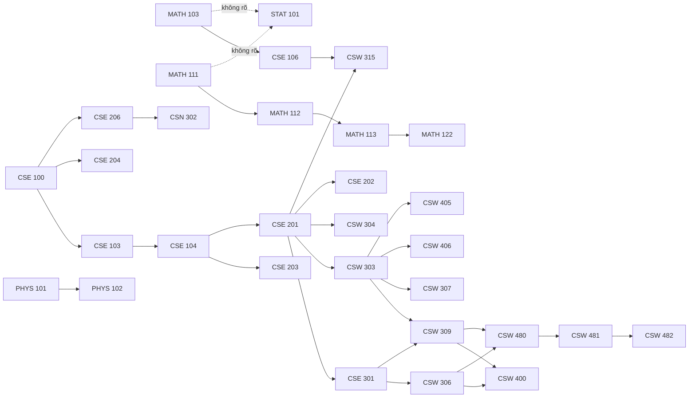
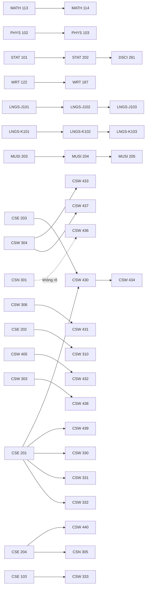

# Đối chiếu môn học KTPM

Nguồn: BSE.pdf (CTĐT 7480103, 78 trang). "tr." là **số trang của file PDF**; số in trên trang nhỏ hơn 2 đơn vị (tr.51 = trang in 49).
Đọc bằng chữ trích và nhìn lại ảnh trang cho mọi bảng quan hệ (tr.49–58, 75–77) và tr.28, 33, 70 cho các chỗ mâu thuẫn.
Bản máy đọc được: `data/courses.ktpm.json` (môn, quan hệ, chiều ngược, trang) và `data/plan.ktpm.json` (lịch game).

## 1. Kết luận ngắn

- **Tiên quyết**: bảng mục VI (tr.49–57) có cột "Mã MH tiên quyết". 32 cạnh giữa các môn bắt buộc (tính cả hai mã của STAT 101).
- **Song hành**: có cột "Mã MH song hành" nhưng **mọi ô đều trống** từ tr.49 đến tr.58. Không môn nào có song hành.
- **Học trước**: PDF **không có cột và không có chữ này**. Vì vậy là "không có trong PDF", không phải "không cần". Câu POLS 134 "có mối quan hệ mật thiết" với POLS 133/135 (tr.8) là mô tả, không phải điều kiện. Đề cương chi tiết (Phụ lục V, tr.78) chỉ có tiêu đề, không có nội dung để đối chiếu thêm.
- Ngoài ra PDF có **điều kiện tiếng Anh** (Level 5 / IELTS 5.5, hoặc IELTS 6.0). Đây là loại thứ tư, dễ bị lẫn với tiên quyết.
- Bảng môn trọng tâm trong brief mục 5–6 **không có môn nào đứng trước tiên quyết** → không cần dời. Các môn còn lại được xếp ở mục 8.
- Danh sách tự chọn: **có đủ trong PDF** (tr.53–58), chỉ là JSON trích sót.
- Không có vòng lặp. Đúng một mã tiên quyết không tồn tại: CSN 301 (của CSW 436).

## 2. Môn bắt buộc (37 môn, 140 TC)

Cột "Học trước" và "Song hành" không in vì cả hai rỗng cho mọi dòng (xem mục 1). "Kỳ PDF" lấy từ bảng tr.49–53; 3.4 là hè năm 3.

| Mã | Tên VI / EN | TC (LT\|TH) | Kỳ PDF | Loại | Tiên quyết (cột PDF) | Điều kiện tiếng Anh | Mở ra môn (chiều ngược) | PDF tr. quan hệ / mô tả |
|---|---|---|---|---|---|---|---|---|
| POLS 133 | Triết học Mác – Lênin / Philosophy of Marxism and Leninism | 4 (4\|0) | 1.1 | Đại cương | — | — | — | 49 / 7 |
| LAWS 122 | Lý luận nhà nước và pháp luật / General Theory of Law and State | 4 (4\|0) | 1.1 | Đại cương | — | — | — | 49 / 10 |
| MATH 103 | Đại số tuyến tính / Linear Algebra | 4 (4\|0) | 1.1 | Đại cương | — | — | CSE 106, STAT 101 | 49 / 14 |
| POLS 134 | Kinh tế chính trị Mác – Lênin / Political Economics of Marxism and Leninism | 3 (3\|0) | 1.2 | Đại cương | — | — | — | 49 / 8 |
| MATH 111 | Giải tích I / Calculus I | 4 (4\|0) | 1.2 | Đại cương | — | — | MATH 112, STAT 101 | 49 / 14 |
| CSE 100 | Nhập môn Công nghệ thông tin / Introduction to Computing | 4 (3\|1) | 1.2 | Cơ sở ngành | — | — | CSE 103, CSE 204, CSE 206 | 50 / 29 |
| CSE 106 | Toán rời rạc I / Discrete Mathematics I | 4 (4\|0) | 1.2 | Cơ sở ngành | MATH 103 | — | CSW 315 | 50 / 30 |
| POLS 135 | Chủ nghĩa xã hội khoa học / Scientific Socialism | 3 (3\|0) | 1.3 | Đại cương | — | — | — | 50 / 8 |
| MATH 112 | Giải tích II / Calculus II | 4 (4\|0) | 1.3 | Đại cương | MATH 111 | — | MATH 113 | 50 / 15 |
| CSE 103 | Lập trình và giải quyết vấn đề I / Programming and Problem Solving I | 4 (3\|1) | 1.3 | Cơ sở ngành | CSE 100 | — | CSE 104, CSW 333 | 50 / 30 |
| POLS 132 | Tư tưởng Hồ Chí Minh / Ho Chi Minh's Ideology | 3 (3\|0) | 2.1 | Đại cương | — | — | — | 50 / 7 |
| MATH 113 | Giải tích III / Calculus III | 4 (4\|0) | 2.1 | Đại cương | MATH 112 | — | MATH 122, MATH 114 | 50 / 15 |
| CSE 104 | Lập trình và giải quyết vấn đề II / Programming and Problem Solving II | 4 (3\|1) | 2.1 | Cơ sở ngành | CSE 103 | — | CSE 203, CSE 201 | 51 / 30 |
| CSE 204 | Mạng máy tính / Computer Networks | 4 (3\|1) | 2.1 | Cơ sở ngành | CSE 100 | IELTS 5.5/Level 5 | CSW 440, CSN 305 | 51 / 32 |
| POLS 136 | Lịch Sử Đảng Cộng Sản Việt Nam / History of Vietnamese Communist Party | 3 (3\|0) | 2.2 | Đại cương | — | — | — | 51 / 9 |
| MATH 122 | Phương trình vi phân / Differential Equations | 4 (4\|0) | 2.2 | Đại cương | MATH 113 | — | — | 51 / 15 |
| CSE 203 | Lập trình hướng đối tượng / Object-Oriented Development | 4 (3\|1) | 2.2 | Cơ sở ngành | CSE 104 | IELTS 5.5/Level 5 | CSW 430 | 51 / 31 |
| CSE 201 | Cấu trúc dữ liệu và giải thuật / Data Structures and Algorithms | 4 (3\|1) | 2.2 | Cơ sở ngành | CSE 104 | IELTS 5.5/Level 5 | CSE 301, CSW 303, CSW 304, CSE 202, CSW 315, CSW 430, CSW 439, CSW 330, CSW 331, CSW 332 | 51 / 30 |
| STAT 101 | Xác suất thống kê / Statistics and Probability | 4 (4\|0) | 2.3 | Đại cương | MATH 111/ MATH 103 (dấu "/": và hay hoặc — không rõ) | — | STAT 202 | 51 / 17 |
| CSE 301 | Cơ sở dữ liệu / Introduction to Databases | 4 (3\|1) | 2.3 | Cơ sở ngành | CSE 201 | IELTS 5.5/Level 5 | CSW 306, CSW 309 | 51 / 32 |
| CSE 206 | Kiến trúc và cấu tạo máy tính / Computer Architecture and Organization | 4 (3\|1) | 2.3 | Cơ sở ngành | CSE 100 | IELTS 5.5/Level 5 | CSN 302 | 51 / 32 |
| PHYS 101 | Vật lý I / Physics I | 4 (3\|1) | 3.1 | Đại cương | — | — | PHYS 102 | 52 / 16 |
| CSW 303 | Kỹ thuật phần mềm / Software Engineering | 4 (3\|1) | 3.1 | Ngành (chuyên ngành BB) | CSE 201 | IELTS 6.0 | CSW 309, CSW 307, CSW 406, CSW 405, CSW 438 | 52 / 33 |
| CSW 304 | Lập trình Front-end / Front-end Development | 4 (3\|1) | 3.1 | Ngành (chuyên ngành BB) | CSE 201 | IELTS 6.0 | CSW 433, CSW 437 | 52 / 34 |
| CSW 306 | Lập trình Back-end / Back-end Development | 4 (3\|1) | 3.1 | Ngành (chuyên ngành BB) | CSE 301 | IELTS 6.0 | CSW 400, CSW 480, CSW 431 | 52 / 34 |
| PHYS 102 | Vật lý II / Physics II | 4 (3\|1) | 3.2 | Đại cương | PHYS 101 | — | PHYS 103 | 52 / 16 |
| CSW 309 | Phân tích và thiết kế hệ thống thông tin / Information System Analysis and Design | 4 (3\|1) | 3.2 | Ngành (chuyên ngành BB) | CSE 301, CSW 303 | IELTS 6.0 | CSW 400, CSW 480 | 52 / 35 |
| CSE 202 | Toán rời rạc II / Discrete Mathematics II | 4 (3\|1) | 3.2 | Cơ sở ngành | CSE 201 | — | CSW 310 | 52 / 31 |
| CSW 307 | Kỹ thuật yêu cầu / Requirement Engineering | 3 (3\|0) | 3.2 | Ngành (chuyên ngành BB) | CSW 303 | IELTS 6.0 | — | 52 / 34 |
| CSW 406 | Kiến trúc phần mềm / Software Architecture | 3 (3\|0) | 3.2 | Ngành (chuyên ngành BB) | CSW 303 | IELTS 6.0 | — | 52 / 36 |
| CSN 302 | Hệ điều hành / Operating System | 4 (3\|1) | 3.3 | Cơ sở ngành | CSE 206 | IELTS 6.0 | — | 52 / 33 |
| CSW 315 | Lý thuyết tính toán / Theory of Computation | 4 (4\|0) | 3.3 | Cơ sở ngành | CSE 201, CSE 106 | IELTS 6.0 | — | 52 / 33 |
| CSW 400 | Thực tập tốt nghiệp Kỹ thuật phần mềm / Computing Internship | 4 (0\|4) | 3.4 | Ngành (chuyên ngành BB) | CSW 306, CSW 309 | IELTS 6.0 | — | 52 / 36 |
| CSW 405 | Kiểm thử và đảm bảo chất lượng phần mềm / Software Testing & Quality Assurance | 4 (3\|1) | 4.1 | Ngành (chuyên ngành BB) | CSW 303 | IELTS 6.0 | CSW 432 | 53 / 35 |
| CSW 480 | Đồ án tốt nghiệp KTPM I / Software Engineering Capstone Project I | 2 (0\|2) | 4.1 | Tốt nghiệp | CSW 306, CSW 309 | IELTS 6.0 | CSW 481 | 53 / 42 |
| CSW 481 | Đồ án tốt nghiệp KTPM II / Software Engineering Capstone Project II | 4 (0\|4) | 4.2 | Tốt nghiệp | CSW 480 | IELTS 6.0 | CSW 482 | 53 / 42 |
| CSW 482 | Đồ án tốt nghiệp KTPM III / Software Engineering Capstone Project III | 4 (0\|4) | 4.3 | Tốt nghiệp | CSW 481 | IELTS 6.0 | — | 53 / 43 |

Không tính tín chỉ: **PED** Giáo dục thể chất (hoàn thành 3 môn GDTC, ghi ở kỳ 1.1, 1.2, 1.3; tr.29, 49, 50) và **MET 100** Giáo dục quốc phòng (chứng chỉ, kỳ 1.4; tr.29, 50). Tên Anh MET 100 khác nhau: "Military Education" (tr.29), "National Defense Education" (tr.50).

## 3. Môn tự chọn

Đại cương tối thiểu 24 TC (4+8+4+4+4), chuyên ngành tối thiểu 16 TC và phải hoàn thành **ít nhất một trong các nhóm 1, 2, 3** (tr.53). Tổng 40 TC.
Cột quan hệ của các môn này ở tr.53–58; học trước và song hành đều không có.

### Khoa học xã hội và hành vi / Social and behavioral sciences — tối thiểu 4 TC (ô PDF: kỳ 2.3)

| Mã | Tên VI / EN | TC (LT\|TH) | Tiên quyết | Tiếng Anh | Mở ra | PDF tr. quan hệ / mô tả |
|---|---|---|---|---|---|---|
| ANT 110 | Nhân học văn hóa / Cultural Anthropology | 4 (4\|0) | — | — | — | 55 / 10 |
| CIVI 101 | Lịch sử văn minh thế giới / The Story of Civilization | 4 (4\|0) | — | — | — | 55 / 10 |
| PSYC 154 | Tâm lý học / Psychology | 4 (4\|0) | — | IELTS 5.5/IELP 5 | — | 55 / 11 |
| SOC 144 | Xã hội học / Sociology | 4 (4\|0) | — | IELTS 5.5/IELP 5 | — | 55 / 11 |
| BUS 101 | Quản trị kinh doanh căn bản / Fundamentals of Business Administration | 4 (4\|0) | — | IELTS 6.0 | — | 55 / 11 |
| EBS 110 | Kinh tế kỹ thuật / Engineering Economy | 4 (4\|0) | — | — | — | 55 / 12 |
| ECO 110 | Nguyên lý kinh tế học / Principles of Economics | 4 (4\|0) | — | — | — | 55 / 12 |
| FIN 239 | Tài chính cá nhân / Personal Finance | 4 (4\|0) | — | IELTS 6.0 | — | 55 / 12 |
| IEPS 100 | Tư duy kinh doanh / Entrepreneurial Thinking | 4 (4\|0) | — | — | — | 55 / 13 |
| IREL 101 | Nhập môn quan hệ quốc tế / Foundations of International Relations | 4 (4\|0) | — | — | — | 56 / 14 |

### Khoa học tự nhiên và tư duy định lượng / Natural sciences and quantitative reasoning — tối thiểu 8 TC (ô PDF: kỳ 3.3)

| Mã | Tên VI / EN | TC (LT\|TH) | Tiên quyết | Tiếng Anh | Mở ra | PDF tr. quan hệ / mô tả |
|---|---|---|---|---|---|---|
| MATH 114 | Giải tích IV / Calculus IV | 4 (4\|0) | MATH 113 | — | — | 56 / 17 |
| MTH 171 | Toán ứng dụng trong kinh doanh / Mathematics Applications for Business | 4 (4\|0) | — | IELTS 6.0 | — | 56 / 17 |
| MATH 104 | Giải tích đa biến / Multivariate calculus | 4 (4\|0) | — | — | — | 56 / 17 |
| PHYS 103 | Vật lý III / Physics III | 4 (3\|1) | PHYS 102 | — | — | 56 / 18 |
| CHEM 100 | Hóa đại cương / General Chemistry | 4 (3\|1) | — | — | — | 56 / 17 |
| STAT 202 | Xác suất thống kê II / Statistics and Probability II | 4 (4\|0) | STAT 101 | — | DSCI 261 | 56 / 18 |

### Công nghệ số / Digital literacy — tối thiểu 4 TC (ô PDF: kỳ 1.1)

| Mã | Tên VI / EN | TC (LT\|TH) | Tiên quyết | Tiếng Anh | Mở ra | PDF tr. quan hệ / mô tả |
|---|---|---|---|---|---|---|
| INFO 101 | Truyền thông, thông tin và xã hội / Communication, Information and Society | 4 (4\|0) | — | — | — | 56 / 19 |
| INFO 106 | Công nghệ số / Focused Inquiry: Digital Literacy | 4 (4\|0) | — | — | — | 56 / 19 |
| INFO 201 | Tư duy tính toán / Computational Thinking | 4 (3\|1) | — | — | — | 56 / 19 |
| DSCI 130 | Quyền riêng tư dữ liệu và công nghệ / Data Privacy and Technology | 4 (3\|1) | — | — | — | 56 / 20 |
| DSCI 261 | Nhập môn Khoa học dữ liệu sử dụng Python / Introduction to Data Science using Python | 4 (3\|1) | STAT 202 | — | — | 57 / 20 |

### Giao tiếp, ngôn ngữ và nghệ thuật / Communications, languages and arts — tối thiểu 4 TC (ô PDF: kỳ 1.3)

| Mã | Tên VI / EN | TC (LT\|TH) | Tiên quyết | Tiếng Anh | Mở ra | PDF tr. quan hệ / mô tả |
|---|---|---|---|---|---|---|
| WRT 122 | Viết luận tiếng Anh / English Composition | 4 (4\|0) | — | IELTS 5.5/Level 5 | WRT 187 | 57 / 21 |
| WRT 187 | Kỹ năng đọc và viết học thuật / Academic Reading and Writing | 4 (4\|0) | WRT 122 | IELTS 5.5/Level 5 | — | 57 / 22 |
| PHL 255 | Tư duy phản biện và sáng tạo / Critical and Creative Thinking | 4 (4\|0) | — | IELTS 5.5/Level 5 | — | 57 / 22 |
| COMS 101 | Kỹ năng giao tiếp / Communication Skills | 4 (4\|0) | — | — | — | 57 / 21 |
| LNGS-J101 | Tiếng Nhật 1 / Japanese 1 | 4 (4\|0) | — | IELTS 6.0 | LNGS-J102 | 57 / 23 |
| LNGS-J102 | Tiếng Nhật 2 / Japanese 2 | 4 (4\|0) | LNGS-J101 | IELTS 6.0 | LNGS-J103 | 57 / 23 |
| LNGS-J103 | Tiếng Nhật 3 / Japanese 3 | 4 (4\|0) | LNGS-J102 | IELTS 6.0 | — | 57 / 23 |
| LNGS-K101 | Tiếng Hàn 1 / Korean 1 | 4 (4\|0) | — | IELTS 6.0 | LNGS-K102 | 57 / 23 |
| LNGS-K102 | Tiếng Hàn 2 / Korean 2 | 4 (4\|0) | LNGS-K101 | IELTS 6.0 | LNGS-K103 | 57 / 23 |
| LNGS-K103 | Tiếng Hàn 3 / Korean 3 | 4 (4\|0) | LNGS-K102 | IELTS 6.0 | — | 57 / 24 |
| MUSI 110 | Lý thuyết Âm nhạc / Music Theory | 4 (4\|0) | — | — | — | 57 / 24 |
| MUSI 203 | Âm nhạc 1 / Music 1 | 4 (4\|0) | — | — | MUSI 204 | 57 / 25 |
| MUSI 204 | Âm nhạc 2 / Music 2 | 4 (4\|0) | MUSI 203 | — | MUSI 205 | 57 / 25 |
| MUSI 205 | Âm nhạc 3 / Music 3 | 4 (4\|0) | MUSI 204 | — | — | 57 / 25 |

### Các chủ đề nghiên cứu mở rộng trong cơ sở giáo dục đại học / University Studies — tối thiểu 4 TC (ô PDF: kỳ 1.2)

| Mã | Tên VI / EN | TC (LT\|TH) | Tiên quyết | Tiếng Anh | Mở ra | PDF tr. quan hệ / mô tả |
|---|---|---|---|---|---|---|
| UNIV 111 | Phát triển bền vững / Focused Inquiry: Sustainability | 4 (4\|0) | — | IELTS 5.5/IELP 5 | — | 58 / 25 |
| UNIV 112 | Toàn cầu hóa / Focused Inquiry: Globalization | 4 (4\|0) | — | IELTS 5.5/IELP 5 | — | 58 / 26 |
| UNIV 226 | Thành phố và cộng đồng thông minh / Focused Inquiry: Smart Cities and Communities | 4 (4\|0) | — | IELTS 5.5/IELP 5 | — | 58 / 26 |
| MGMT 291 | Chuyên đề thời sự đương đại / Seminar in Current Affairs | 4 (4\|0) | — | IELTS 5.5/IELP 5 | — | 58 / 27 |
| HLTH 130 | Nghiên cứu sáng tạo về Chăm sóc sức khỏe / Healthcare and Creative Inquiry | 4 (4\|0) | không rõ | không rõ | — | không có / 27 |
| PSYC 110 | Hạnh phúc và Phúc lợi / Happiness and Well-being | 4 (4\|0) | không rõ | không rõ | — | không có / 28 |
| UNIV 101 | Sự tự chủ và phát triển bản thân / The Intentional Self | 4 (4\|0) | không rõ | không rõ | — | không có / 28 |

### Nhóm 1. Phát triển ứng dụng di động / Group 1. Mobile application development (ô PDF: kỳ 4.1, 4.2)

| Mã | Tên VI / EN | TC (LT\|TH) | Tiên quyết | Tiếng Anh | Mở ra | PDF tr. quan hệ / mô tả |
|---|---|---|---|---|---|---|
| CSW 430 | Phát triển ứng dụng di động / Mobile Application Development | 4 (3\|1) | CSE 201, CSE 203 | IELTS 6.0 | CSW 434 | 53 / 36 |
| CSW 434 | Phát triển ứng dụng di động nâng cao / Advanced Mobile Application Development | 4 (3\|1) | CSW 430 | IELTS 6.0 | — | 54 / 38 |

### Nhóm 2. Phát triển Front-end / Group 2. Front-end development (ô PDF: kỳ 4.1, 4.2)

| Mã | Tên VI / EN | TC (LT\|TH) | Tiên quyết | Tiếng Anh | Mở ra | PDF tr. quan hệ / mô tả |
|---|---|---|---|---|---|---|
| CSW 433 | Lập trình Front-end nâng cao / Advanced Front-end Development | 4 (3\|1) | CSW 304 | IELTS 6.0 | — | 54 / 37 |
| CSW 437 | Thiết kế trải nghiệm người dùng / User Interface and Experience (UI/UX) Design | 4 (3\|1) | CSW 304 | IELTS 6.0 | — | 54 / 39 |

### Nhóm 3. Phát triển Back-end / Group 3. Back-end development (ô PDF: kỳ 4.1, 4.2)

| Mã | Tên VI / EN | TC (LT\|TH) | Tiên quyết | Tiếng Anh | Mở ra | PDF tr. quan hệ / mô tả |
|---|---|---|---|---|---|---|
| CSW 436 | Cơ sở dữ liệu nâng cao / Advanced Databases | 4 (3\|1) | CSN 301 ⚠ mã không tồn tại | IELTS 6.0 | — | 54 / 38 |
| CSW 431 | Phát triển Back-end nâng cao / Advanced Back-end Development | 4 (3\|1) | CSW 306 | IELTS 6.0 | — | 54 / 36 |

### Nhóm 4. Tự chọn khác / Group 4. Other electives (ô PDF: kỳ 4.1, 4.2)

| Mã | Tên VI / EN | TC (LT\|TH) | Tiên quyết | Tiếng Anh | Mở ra | PDF tr. quan hệ / mô tả |
|---|---|---|---|---|---|---|
| CSW 435 | Quản lý dự án / Project Management | 4 (4\|0) | — | IELTS 6.0 | — | 54 / 38 |
| CSW 310 | Phân tích và thiết kế giải thuật / Analysis and Design of Algorithms | 4 (3\|1) | CSE 202 | IELTS 6.0 | — | 54 / 39 |
| CSW 432 | Kiểm thử tự động / Automation Testing | 4 (3\|1) | CSW 405 | IELTS 6.0 | — | 54 / 37 |
| CSW 438 | Phát triển phần mềm và vận hành hệ thống / Software Development and IT Operations (DevOps) | 4 (3\|1) | CSW 303 | IELTS 6.0 | — | 54 / 39 |
| CSW 439 | Khai thác dữ liệu / Data Mining | 4 (3\|1) | CSE 201 | IELTS 6.0 | — | 54 / 40 |
| CSW 440 | Bảo mật phần mềm / Software security | 4 (3\|1) | CSE 204 | IELTS 6.0 | — | 54 / 40 |
| CSW 330 | Trí tuệ nhân tạo / Artificial Intelligence | 4 (3\|1) | CSE 201 | IELTS 6.0 | — | 54 / 40 |
| CSW 331 | Xử lý ảnh / Image Processing | 4 (3\|1) | CSE 201 | IELTS 6.0 | — | 55 / 41 |
| CSW 332 | Máy học và ứng dụng / Machine Learning and applications | 4 (3\|1) | CSE 201 | IELTS 6.0 | — | 55 / 41 |
| CSW 333 | Phương pháp nghiên cứu khoa học / Research methodology | 4 (3\|1) ⚠ | CSE 103 | IELTS 6.0 | — | 55 / 41 |
| CSN 305 | Điện toán đám mây / Cloud Computing | 4 (3\|1) | CSE 204 | IELTS 6.0 | — | 55 / 42 |

Ba môn HLTH 130, PSYC 110, UNIV 101 có mô tả ở tr.27–28 nhưng không có trong bảng tự chọn tr.58 → tiên quyết và điều kiện tiếng Anh: **không rõ**, chưa cho đăng ký.
UNIV 111, 112, 226 và MGMT 291: "IELP 5" chỉ có trong chữ PDF, không được giải thích; có thể là Level 5 nhưng **không rõ**.

## 4. Đồ thị tiên quyết

Mũi tên A → B: A là tiên quyết của B, tức "A mở ra B". Nét đứt: PDF không rõ hoặc mã không tồn tại.

**Bắt buộc**

**Tự chọn**

## 5. Mâu thuẫn và lỗi trong PDF

| # | Chỗ | Nội dung | Cách dùng trong game |
|---|---|---|---|
| 1 | tr.54 | CSW 436 cần **CSN 301**, mã này không có ở bất kỳ bảng nào. Có thể định viết CSE 301, nhưng chưa xác nhận. | `unresolved`, chưa cho đăng ký |
| 2 | tr.52 ↔ tr.33, 62, 68, 75, 77 | Hệ điều hành: **CSN 302** (tr.52) còn năm chỗ kia là **CSE 302** | Giữ khóa `CSN 302` như JSON, alias `CSE 302`, hỏi lại |
| 3 | tr.51 ↔ tr.77 | STAT 101 tiên quyết "MATH 111/ MATH 103": dấu "/" là và hay hoặc **không rõ**. Lưu đồ chỉ vẽ MATH 103 → STAT 101 | Kiểm theo hướng chặt (cần cả hai). Cả hai đã học trước năm 2 kỳ 2 nên không ảnh hưởng |
| 4 | tr.53 ↔ tr.6, 43 | Bảng kỳ ghi TỔNG **183**, mục IV ghi **180**. Cộng từng môn ra đúng **180**: kỳ 3.1 ghi 15 (12\|3) nhưng bốn môn 4 (3\|1) là 16 (12\|4); kỳ 4.3 ghi 8 (3\|5) nhưng chỉ có CSW 482 4 (0\|4). Sai +4 −1 = +3 | Dùng 180 |
| 5 | tr.75–76 ↔ tr.52–53 | Kế hoạch chuẩn ghi CSW 307 = 4 TC (bảng: 3) và CSW 480 = 4 TC (bảng: 2). Hai chỗ này cũng làm tổng thành 183 | Theo bảng: 3 và 2 (mô tả tr.34, 42 và lưu đồ tr.77 cùng ghi 3 và 2) |
| 6 | tr.55 ↔ tr.41, 69 | CSW 333: 4 (3\|1) ở bảng, 4 (4\|0) ở mô tả và ma trận | Không rõ có lab hay không; chưa dùng mặc định |
| 7 | tr.70 | Ma trận ghi **CSW 434 hai lần**: "Advanced Mobile" và "Front-end Development" | Bỏ dòng thứ hai; Front-end là CSW 304 (tr.34, 52) |
| 8 | tr.50 ↔ tr.58 | Ô "Các chủ đề nghiên cứu" đặt ở kỳ 1.2, nhưng bốn môn trong bảng đều cần IELTS 5.5/IELP 5 | Trong game chỉ xếp sau Level 5 |
| 9 | tr.50 ↔ tr.57 | Ô "Giao tiếp, ngôn ngữ, nghệ thuật" ở 1.3: nhiều môn cần Level 5 hoặc IELTS 6.0 (COMS 101 và nhóm MUSI thì không) | Như trên |
| 10 | tr.49 ↔ tr.57 | DSCI 261 thuộc ô kỳ 1.1 nhưng cần STAT 202, mà STAT 202 cần STAT 101 (2.3) | Chỉ mở khi đủ tiên quyết |
| 11 | tr.52, 53 ↔ tr.54, 56 | Ô tự chọn ghi 8 (8\|0) và 8 (6\|2), nhưng có môn trong nhóm mang LT/TH khác (PHYS 103, CHEM 100 là 3\|1; CSW 435 là 4\|0) | Lấy LT/TH theo môn chọn |
| 12 | nhiều trang | Tên lệch: Kinh tế (và) chính trị; Toán rời rạc 2/II; STAT 101 có/không "I"; Operating System(s); "Level 5" (tr.51) và "IELP 5" (tr.55, 58) | Chuẩn hóa tên trong `courses.ktpm.json` |
| 13 | tr.57 | "LNGS - J101" có khoảng trắng | Khóa `LNGS-J101` |

Các quan hệ bắt buộc còn lại **khớp** giữa bảng (tr.49–53) và lưu đồ (tr.77): 31/32 cạnh, chỉ lệch ở #3. Phụ lục IV phần bảng (tr.75–76) và phụ lục II không ghi quan hệ.

## 6. Khác với `ktpm.curriculum.json`

| Chỗ | JSON hiện tại | PDF |
|---|---|---|
| `block` | mọi môn là `nganh` (trừ đồ án) | 52 TC đại cương, 48 cơ sở ngành, 30 ngành, 10 tốt nghiệp (tr.6) — mục 2 đã xếp lại và khớp tổng |
| `prerequisites` | không có ở môn nào | có ở tr.50–53 |
| `electiveGroups[].courses` | bảy nhóm đều rỗng | có ở tr.53–58 (mục 3) |
| Tên nhóm | bị cắt: "Giao tiếp\| ngôn ngữ và", "Khoa học xã hội và hành" (EN là "vi"), "Khoa học tự nhiên và tư", "Các chủ đề nghiên cứu" | tên đầy đủ ở mục 3 |
| Chuyên ngành | một ô tách hai, không có nhóm | bốn nhóm + luật "ít nhất một trong nhóm 1–3" |
| CSW 480, 481 | chữ "I"/"II" dính sang tên Anh | "... KTPM I / Software Engineering Capstone Project I" |
| PED, MET 100 | không có | có, không tính tín chỉ |
| Điều kiện tiếng Anh | không có | có |
| Hệ điều hành | CSN 302 | hai mã (mục 5 #2) |

Mã, tín chỉ, LT/TH, năm/kỳ của 37 môn bắt buộc **khớp** bảng tr.49–53. Plan này không sửa file đó: dữ liệu mới nằm riêng ở `src/data/silver/`. `scripts/ctdt/check.mjs` đang chấp nhận cả 180 và 183; giữ nguyên.

## 7. Kiểm lịch brief mục 5–6

| Mốc | Môn trọng tâm | Tiên quyết | Đã có ở | Kết quả |
|---|---|---|---|---|
| L5 (2.1) | CSE 106 | MATH 103 | L2 | Đạt |
| 2.2 | CSE 103 | CSE 100 | L5 | Đạt |
| 2.3 | CSE 104 | CSE 103 | 2.2 | Đạt |
| 2 hè | CSE 203 | CSE 104 | 2.3 | Đạt |
| 3.1 | CSE 201 | CSE 104 | 2.3 | Đạt |
| 3.2 | CSE 301 | CSE 201 | 3.1 | Đạt |
| 3.3 | CSW 303 | CSE 201 | 3.1 | Đạt |
| 3 hè | CSW 304 | CSE 201 | 3.1 | Đạt |
| 4.1 | CSW 306 | CSE 301 | 3.2 | Đạt |
| 4.2 | CSW 307 | CSW 303 | 3.3 | Đạt |
| 4.3 | CSW 309 | CSE 301, CSW 303 | 3.2, 3.3 | Đạt |
| 4 hè | CSW 400 | CSW 306, CSW 309 | 4.1, 4.3 | Đạt |
| 5.1 | CSW 405; CSW 480 | CSW 303; CSW 306 + 309 | 3.3; 4.1, 4.3 | Đạt |
| 5.2 / 5.3 | CSW 481 / 482 | CSW 480 / 481 | 5.1 / 5.2 | Đạt |

Level 1–4 chỉ dùng môn không có tiên quyết. Level 5 và IELTS 6.0 xong trước 2.2 nên mọi điều kiện tiếng Anh đều thỏa.
**Chỉnh tối thiểu đề xuất:** không dời môn nào. Chỉ ghi rõ MATH 103 phải giữ ở Level 2 (vì CSE 106) và CSE 100 phải trước CSE 103.
PDF xếp ba môn GDTC ở 1.1–1.3 và GDQP ở 1.4. Brief nên để thể chất ở Level 1–3; hè Level 4 có thể là GDQP (hỏi chủ dự án).

## 8. Bộ môn gợi ý (lịch trải nghiệm, **không phải** thời khóa biểu EIU)

In đậm: trọng tâm. Dấu \*: tự chọn mặc định, người chơi đổi được. Không cố đủ 16.

| Kỳ | Môn | TC |
|---|---|---|
| 1.1–2.1 | POLS 133 · MATH 103, LAWS 122 · MATH 111, POLS 134 · (hè) · CSE 100, CSE 106 | 27 |
| 2.2 | **CSE 103**, MATH 112, POLS 135, COMS 101\* | 15 |
| 2.3 | **CSE 104**, MATH 113, CSE 204, POLS 132 | 15 |
| 2 hè | **CSE 203**, INFO 106\* | 8 |
| 3.1 | **CSE 201**, CSE 206, MATH 122, POLS 136 | 15 |
| 3.2 | **CSE 301**, CSE 202, STAT 101, PHYS 101 | 16 |
| 3.3 | **CSW 303**, CSN 302, PHYS 102, PSYC 154\* | 16 |
| 3 hè | **CSW 304**, UNIV 111\* | 8 |
| 4.1 | **CSW 306**, CSW 406, STAT 202\* | 11 |
| 4.2 | **CSW 307**, CSW 437\*, MATH 114\* | 11 |
| 4.3 | **CSW 309**, CSW 315, CSW 433\* | 12 |
| 4 hè | **CSW 400** | 4 |
| 5.1 | **CSW 405**, **CSW 480**, CSW 435\* | 10 |
| 5.2 | **CSW 481**, CSW 438\* | 8 |
| 5.3 | **CSW 482** | 4 |
| 5 hè | chương tốt nghiệp | 0 |

Kiểm bằng script: 37 môn bắt buộc có đủ, không trùng, mọi tiên quyết nằm ở kỳ trước, đủ năm ô đại cương (4, 8, 4, 4, 4), 16 TC chuyên ngành gồm trọn nhóm 2. Tổng **180**. Đổi môn trong game không kiểm lại tổng (brief mục 2).
