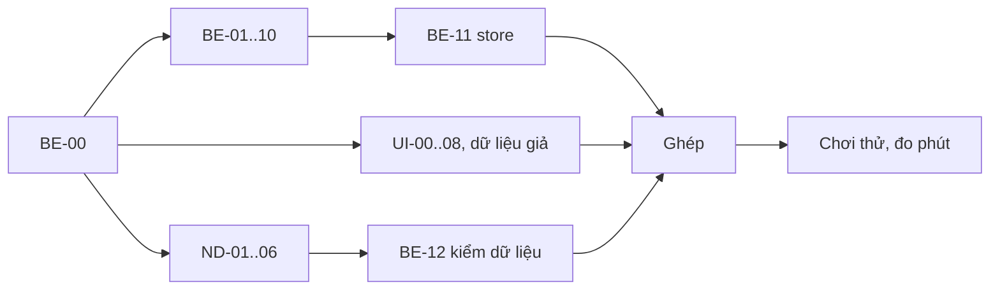

# Kế hoạch: Cuộc sống IT Silver — bản thử

Đọc cùng: `BRIEF.md` (ý tưởng đã duyệt), `MON-HOC.md` (môn và tiên quyết), `HOP-DONG.md` (kiểu, API). Agent UI vào bằng `BAT-DAU-UI.md`.
Bản thử = **kiểm tra đầu vào → Level 1 (1.1) → năm 2 kỳ 2 (2.2)** với CSE 103 trọng tâm, các môn cùng kỳ tóm gọn. Chương khác chỉ hiện "Sắp có".

## B. Thiết kế một kỳ

### B1. Thời gian nén

| Loại | Nội dung | Phút |
|---|---|---|
| Trọng tâm, có lab | 4 buổi nhỏ (2 trong lab) + thi | 12–16 |
| Tóm gọn, có lab | lý thuyết A + B (1–1,5 mỗi buổi) + lab 2–3 | 4–6 |
| Tóm gọn, không lab | lý thuyết A + B (1,5–2 mỗi buổi) | 3–4 |
| Nhanh (môn thứ 5, 6) | có lab: chỉ chơi lab; không lab: chỉ lý thuyết A | 2 |
| Đăng ký + mở đầu + cảnh cuối + sổ | | 5–6 |

Kỳ 2.2 gợi ý: 14,5 + 3 × 3,5 + 5,5 ≈ **31 phút**. Thêm một môn: +2. Đổi một môn không lab thành có lab: +1–1,5. Trần thực tế (6 môn, nhiều lab) khoảng 39 phút; màn đăng ký luôn hiện ước tính, quá 35 thì nhắc nhẹ, không chặn. Các kỳ hè, thực tập, đồ án (0|n): 1 buổi `project` + 1–2 cảnh, 10–20 phút. Lưu ở ranh giới từng buổi.
Đây là ước lượng để soạn; đo thật ở UI-08 rồi chỉnh.

### B2. Tuần tiêu biểu

Sáu ngày × 4 ca 2 giờ (2 sáng, 2 chiều), **giờ minh họa**. Lab = 2 ca liền trong một buổi (4 tiếng). Mỗi môn 2 buổi lý thuyết ở hai ngày khác nhau. Kết quả thật của thuật toán cho 2.2 mặc định:

| | T2 | T3 | T4 | T5 | T6 | T7 |
|---|---|---|---|---|---|---|
| Ca 1 | CSE 103 lab | MATH 112 A | CSE 103 A | MATH 112 B | CSE 103 B | |
| Ca 2 | CSE 103 lab | POLS 135 A | COMS 101 A | POLS 135 B | COMS 101 B | |
| Ca 3–4 | | | | | | |

Lab môn trọng tâm luôn đầu tuần, nên CSE 103 đi: lab (chào, biến) → A (điều kiện) → B (vòng lặp) → thi.
PDF ghi môn 3|1 là 30 giờ LT + 30 giờ TH, kế hoạch 10 tuần → trung bình 3 giờ LT + 3 giờ TH/tuần; chủ dự án mô tả lab 4 tiếng. Game theo chủ dự án (xem câu hỏi Q3). Môn 4|0: 40 giờ/10 tuần; game để 2 buổi (giả định, Q4).

### B3. Trùng giờ, đổi môn, thêm môn

- Xếp tự động, tất định (BE-04). 24 ca đủ cho tối đa 6 môn có lab, nên **không có trùng giờ** để người chơi xử lý. Đổi môn là xếp lại cả tuần ngay.
- Môn trọng tâm khóa. Môn khác bỏ/thêm được. 2.2: ít nhất 3, nhiều nhất 6 môn. Không chặn theo tổng tín chỉ.
- Chỉ đăng ký được môn **có nội dung** và đủ tiên quyết. Thiếu tiên quyết: khóa, ghi tên môn thiếu. PDF không rõ: khóa, ghi "chờ xác nhận".
- "Đã học" mặc định = mọi môn các kỳ trước trong lịch gợi ý, nên vào thẳng chương nào cũng được. Bỏ một môn không làm khóa các kỳ sau; môn đã bỏ có thể chọn lại.
- Mọi môn đã đăng ký đều được chơi ít nhất một buổi.

### B4. Khuôn nội dung môn tóm gọn

Một file `CourseContent` (kiểu ở `data/silver.types.txt`), một thợ làm 30–45 phút:

| Phần | Khuôn | Giới hạn |
|---|---|---|
| `summary` | môn này để làm gì, 1 câu | ≤ 25 từ mỗi ngôn ngữ |
| `theoryA` | 1 `say` mở + 1 `slide` (1 ý) + 1 `question`/`choice` | 1–2 phút, ≤ 130 từ VI |
| `theoryB` | 1 `slide` (ý thứ hai) + 1 `question`/`order` | 1–2 phút, ≤ 130 từ VI |
| `lab` (nếu TH > 0) | 1 `say` + 1 `slide` + 1–2 `code`/`question`/`order` | 2–3 phút, ≤ 200 từ VI |
| `closing` | câu kết môn | ≤ 25 từ |

Luật: cả `vi` và `en`; chỉ lấy ý từ mô tả môn trong PDF, ghi `basis.pdfPages`; không bịa tên giảng viên, giáo trình, đề thi, phòng, quy chế; không trích văn bản có bản quyền; môn chính trị bám mô tả PDF, trung tính; đáp án chỉ một cách hiểu; `basis.note` ghi "mô phỏng ngắn". `project`: 1 cảnh `project` 4–8 phút thay cho theory/lab.

## C. Việc, thứ tự, người làm

Ước lượng là giờ làm của một agent, không tính chờ duyệt.

### C1. BE — Codex gpt-6-luna

| Thứ tự | Task | Phụ thuộc | Giờ |
|---|---|---|---|
| 1 | `tasks/BE-00-kieu-va-test.md` | — | 0,5 |
| 2 | `tasks/BE-01-danh-muc-mon.md` | 00 | 1 |
| 3 | `tasks/BE-02-tien-quyet.md` | 00 | 1 |
| 4 | `tasks/BE-03-lich-game.md` | 00, 01, 02 | 0,5 |
| 5 | `tasks/BE-04-xep-tuan.md` | 00 | 1 |
| 6 | `tasks/BE-05-diem.md` | 00 | 0,5 |
| 7 | `tasks/BE-06-noi-dung.md` | 00 | 1,5 |
| 8 | `tasks/BE-07-dang-ky.md` | 01–04 | 1,5 |
| 9 | `tasks/BE-08-luot-choi.md` | 00, 04 | 1,5 |
| 10 | `tasks/BE-09-luu.md` | 00 | 1 |
| 11 | `tasks/BE-10-so-ky-niem.md` | 00 | 0,5 |
| 12 | `tasks/BE-11-store.md` | 01–10 | 2 |
| 13 | `tasks/BE-12-kiem-du-lieu.md` | 01, 03, 06 | 1 |

Sau BE-00, chạy song song được: 01, 02, 04, 05, 06, 09, 10 (mỗi task file riêng). Gộp từng task, chạy `npm run typecheck && npm run lint && npm run build && npm run test:silver`.

### C2. UI — agent máy đồng đội

Vào bằng `BAT-DAU-UI.md`. UI-00 → UI-01 → … → UI-08, tổng khoảng 14 giờ. Chỉ cần kiểu (BE-00 hoặc bản chép), không chờ BE khác, không chờ ND.

### C3. ND — nội dung song ngữ

| Task | Giờ | Ai có thể làm |
|---|---|---|
| `tasks/ND-01-dau-vao.md` | 1,5 | Claude viết; người biết EIU đọc lại |
| `tasks/ND-02-level-1.md` | 2 | Claude viết; chủ dự án duyệt giọng ba bạn |
| `tasks/ND-03-cse-103.md` | 2 | Claude hoặc Codex viết; người biết Java kiểm |
| `tasks/ND-04-mon-tom-gon.md` (MATH 112, POLS 135, COMS 101) | 2 | Codex/Antigravity theo khuôn; Claude duyệt |
| `tasks/ND-05-mon-doi.md` (CSE 204, STAT 101) | 1,5 | như trên, sau ND-04 |
| `tasks/ND-06-ky-2-2.md` | 1 | Claude |

Mỗi bản `status: "nhap"` cho tới khi chủ dự án duyệt. ND song song với BE và UI; nếu BE-06 xong thì thợ ND chạy `npm run check:silver`.

### C4. Thứ tự chung

### C5. Ghép và hậu kỳ (bên chủ dự án, dự kiến ≤ 2 giờ)

1. Gộp nhánh `it-silver/be`, rồi `it-silver/nd`, rồi `it-silver/ui` vào nhánh tổng hợp từ `origin/main`.
2. Sửa **một dòng** trong `src/ui/silver/adapter.ts`: xuất `useSilverStore` thay `useSilverMock`.
3. Chạy typecheck, lint, build, `test:silver`, `check:silver`.
4. Chơi thử theo `UI-TU-KIEM.md` mục 2 bằng dữ liệu thật, đo phút từng chương.
5. Hậu kỳ nhẹ: chỉnh câu chữ, số phút, màu theo quyết định mỹ thuật.
6. Chủ dự án duyệt → vào main.

Nếu bước 2 cần sửa hơn 5 dòng UI: trả lại bên UI kèm lỗi, không vá tại chỗ.

### C6. Tiêu chí bản thử

Theo BRIEF mục 8, cộng: đăng ký 2.2 đổi/thêm được môn; mọi môn đã chọn đều chơi ít nhất một buổi; cùng một bản lưu thì điểm, tuần học luôn giống nhau; chạy được khi localStorage bị chặn.

### C7. Ngoài phạm vi bản thử

Supabase/đăng nhập (**tùy chọn để sau**: thay lớp đọc/ghi trong `src/silver/save.ts`, không đổi UI), nhiều người chơi, giọng nói, ngồi ghế 3D ở B8, nội thất B10 (repo hiện chưa có), rớt môn, GPA, ngành khác, các chương sau 2.2. Phòng 406.B8 đã dựng hình nhưng chưa có dữ liệu ghế/buổi học; `Lesson406` đang viết riêng cho 406.B11, nên bản thử chơi bằng lớp phủ 2D.

## D. Cần chủ dự án xác nhận

Không câu nào chặn việc; mặc định ghi sẵn.

| # | Câu hỏi | Mặc định đang dùng |
|---|---|---|
| Q1 | CSW 436 cần "CSN 301": có phải CSE 301? | khóa môn này |
| Q2 | Hệ điều hành là CSN 302 hay CSE 302? | khóa CSN 302, alias CSE 302 |
| Q3 | Lab 4 tiếng/tuần (PDF trung bình 3 giờ TH/tuần): giữ 4? | 4 tiếng, ghi "minh họa" |
| Q4 | Môn không lab: 2 buổi lý thuyết/tuần? | 2 |
| Q5 | STAT 101: cần cả MATH 111 và MATH 103, hay một trong hai? | cả hai |
| Q6 | HLTH 130, PSYC 110, UNIV 101 còn mở cho KTPM không? "IELP 5" có phải Level 5? | chưa cho đăng ký ba môn; IELP 5 chỉ ghi chú |
| Q7 | Tự chọn mặc định trong MON-HOC mục 8 (COMS 101, INFO 106, PSYC 154, UNIV 111, STAT 202, MATH 114, nhóm 2 Front-end, CSW 435, 438) được chưa? | dùng |
| Q8 | CSE 103 dạy Java? PDF không ghi ngôn ngữ | Java như `nmlt-01` |
| Q9 | Hè Level 4 có kể Giáo dục quốc phòng (PDF kỳ 1.4)? | chưa, ngoài bản thử |
| Q10 | Cho phép 6 môn (≈39 phút) hay trần 5? | 6 |
| Q11 | "Học trước" và song hành: có nguồn khác ngoài BSE.pdf (cổng đăng ký môn) không? | không có |
| Q12 | CSW 333 có lab không (bảng 3\|1, mô tả 4\|0)? | chưa dùng |
| Q13 | Mỹ thuật: trang phục/ảnh đại diện Thành, Quyền, Han; ảnh kỷ niệm vẽ hay chụp cảnh 3D? | chữ cái trong vòng tròn màu; khung ảnh có emoji cảnh |
| Q14 | Tên "Silver" hiện trên giao diện thế nào? | "Cuộc sống IT Silver" / "IT Silver Life" |
| Q15 | Duyệt giọng và lời thoại ba bạn; CLB thật nào được nêu tên | không nêu tên CLB |
